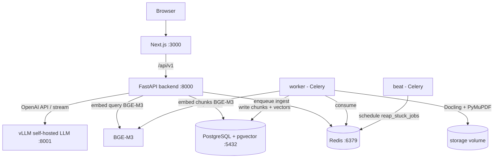

# DocuPilot

DocuPilot is a multilingual, AI-powered **PDF chat platform**. Upload one or many
PDFs and chat with them, generate summaries, compare documents, search content,
and export AI-generated content back to PDF — all running **fully self-hosted and
offline** after the initial model download.

It runs as a set of small services orchestrated with Docker Compose. There is **no
authentication** — DocuPilot behaves as a local, unrestricted workspace. The LLM
is always a **self-hosted OpenAI-compatible** endpoint (vLLM in the Compose
stacks). DocuPilot never routes to a hosted cloud LLM provider. For hybrid/dev
you may point the same `VLLM_BASE_URL` contract at Ollama instead — see
[docs/DEVELOPMENT.md](docs/DEVELOPMENT.md).

---

## Documentation

| Doc | Contents |
| --- | --- |
| [docs/ARCHITECTURE.md](docs/ARCHITECTURE.md) | Services, tools, backend layers, FE↔BE integration |
| [docs/DATA_FLOWS.md](docs/DATA_FLOWS.md) | Ingest, chat/RAG, search, and generate sequences |
| [docs/RAG.md](docs/RAG.md) | Chunking, embeddings, pgvector, rerank, citations |
| [docs/BACKEND.md](docs/BACKEND.md) | Modules, domain model, API catalog, Celery |
| [docs/FRONTEND.md](docs/FRONTEND.md) | Routes, data layer, feature flows, i18n |
| [docs/DEVELOPMENT.md](docs/DEVELOPMENT.md) | Local Docker / hybrid / Ollama runbook |

---

## Features

- Upload single or multiple PDFs
- Chat with a single PDF or across multiple PDFs (RAG)
- Ask questions, generate summaries, and compare documents
- Inline **citations** that map answers back to source pages
- Semantic search across all uploaded documents (with cross-encoder reranking on by default)
- Generate new PDFs from AI/Markdown content (Markdown → HTML → PDF)
- Persistent chat history and long conversations
- Automatic multilingual handling (Arabic, English, French, Spanish, …)

---

## Architecture



The `backend` and `frontend` run as **separate containers**. BGE-M3 embeddings run
in-process in both the backend (to embed queries) and the worker (to embed chunks);
set `EMBEDDING_BASE_URL` to offload embedding to a single self-hosted backend if you
prefer the model to load in only one place. Celery **beat** schedules periodic
tasks (for example reaping stuck ingest jobs).

**Technology stack**

| Layer          | Technology                                   |
| -------------- | -------------------------------------------- |
| Frontend       | Next.js, TypeScript, Tailwind CSS, shadcn/ui |
| Backend        | FastAPI (Python 3.12)                        |
| Database       | PostgreSQL + pgvector (HNSW)                 |
| PDF processing | Docling + PyMuPDF                            |
| Embeddings     | BGE-M3 (FlagEmbedding, in-process)           |
| Reranking      | BGE reranker (FlagEmbedding; on by default)  |
| LLM / serving  | Qwen3-AWQ on vLLM (self-hosted)              |
| Queue          | Redis + Celery (worker + beat)               |
| PDF generation | Markdown → HTML → PDF (WeasyPrint)           |
| Deployment     | Docker Compose                               |

---

## Repository structure

```
docupilot/
├── apps/
│   ├── backend/                FastAPI modular monolith
│   │   ├── app/
│   │   │   ├── api/v1/          routers: documents, chats, messages, search, generate, health
│   │   │   ├── services/        orchestration: document, chat, rag, generation
│   │   │   ├── rag/             chunker, embedder (BGE-M3), retriever, reranker, context assembler
│   │   │   ├── ai/              vLLM client, prompts, language detection
│   │   │   ├── pdf/             parser (Docling/PyMuPDF), generator (WeasyPrint)
│   │   │   ├── workers/         Celery app + ingestion tasks
│   │   │   ├── domain/          SQLAlchemy models
│   │   │   ├── db/              engine + sessions (async + sync)
│   │   │   ├── core/            exceptions
│   │   │   ├── config.py        settings
│   │   │   └── main.py          FastAPI app factory
│   │   ├── alembic/             migrations
│   │   └── pyproject.toml
│   └── frontend/                Next.js app (App Router) + shadcn/ui
├── infrastructure/docker/       Dockerfiles + entrypoints (backend, frontend, worker)
├── docker-compose.dev.yml
├── docker-compose.prod.yml
├── Makefile
└── .env.example
```

---

## Quickstart

Prerequisites: **Docker** and **Docker Compose**, plus the **NVIDIA Container
Toolkit** for the GPU that serves the LLM. Nothing else needs to be installed
locally.

```bash
git clone <repo> docupilot && cd docupilot
cp .env.example .env
docker compose -f docker-compose.dev.yml up
```

- Frontend: http://localhost:3000
- API + docs: http://localhost:8000/docs
- vLLM: http://localhost:8001/v1

> The first start downloads the LLM weights and the BGE-M3 model into a cached
> volume (`hf_cache`). After that, DocuPilot runs without internet access (see
> [Self-hosting the model](#self-hosting-the-model)).

---

## Development

See **[docs/DEVELOPMENT.md](docs/DEVELOPMENT.md)** for the full guide, including
the recommended hybrid workflow (Postgres + Redis in Docker, app on the host),
running against a remote LLM or Ollama, and troubleshooting.

`docker compose -f docker-compose.dev.yml up` starts PostgreSQL, Redis, vLLM, the
`backend` (uvicorn `--reload`), the `frontend` (`next dev`), the Celery
`worker`, and Celery `beat`. Source code is mounted, so edits reload automatically.

Common tasks (see `make help`):

```bash
make up           # start dev stack
make logs         # tail logs
make worker-logs  # tail worker logs
make migrate      # apply migrations
make makemigration msg="..."  # autogenerate a migration
make shell-backend
make shell-db     # open psql
make ollama-tunnel  # SSH tunnel to remote Ollama (hybrid; see DEVELOPMENT.md)
make lint         # ruff + eslint
make down         # stop
make clean        # stop and remove volumes
```

---

## Production

```bash
cp .env.example .env        # set a strong POSTGRES_PASSWORD
docker compose -f docker-compose.prod.yml up -d --build
```

Production differences:

- `frontend` is built and served from Next.js **standalone** output; `backend`
  runs under `uvicorn`. They are **separate containers**.
- Database migrations run automatically when the `backend` container starts
  (`backend-entrypoint.sh`).
- The stack includes Celery `worker` and `beat` (periodic stuck-job reaper).
- Containers set `restart: unless-stopped`, memory limits, and health checks.
- The `vllm` service requires an NVIDIA GPU.

---

## Self-hosting the model

Compose always serves the LLM with the bundled **vLLM** service — never a hosted
cloud provider. Pick the model by your GPU's VRAM via the `LLM_MODEL` env var
(approximate footprints; download ≈ VRAM for the 4-bit AWQ weights, plus KV
cache for context):

- **~16 GB GPU:** `Qwen/Qwen3-8B-AWQ` (~6 GB), full 32k context.
- **24 GB GPU (default, recommended):** `Qwen/Qwen3-14B-AWQ` (~9-10 GB), full 32k context.
- **40 GB+ GPU:** `Qwen/Qwen3-32B-AWQ` (~19 GB), full 32k context.

Embeddings (BGE-M3, ~2.3 GB) run on CPU by default to keep VRAM free for the LLM.

For hybrid/dev without a local GPU, point `VLLM_BASE_URL` at remote vLLM or
Ollama (same OpenAI-compatible API). See
[docs/DEVELOPMENT.md](docs/DEVELOPMENT.md).

**Offline-first weight download.** To avoid downloading large weights over a slow
link at runtime:

1. Start the stack once on a machine with good bandwidth so weights are fetched
   into the persistent `hf_cache` volume. `HF_HUB_ENABLE_HF_TRANSFER=1` (set in
   the compose files) speeds up the pull.
2. After the cache is populated, set `HF_HUB_OFFLINE=1` so the runtime never
   reaches the network — true offline operation.

To move a cache between hosts, copy the `hf_cache` Docker volume (or mount a
shared host path to `/root/.cache/huggingface` for vLLM and `/models` for the
backend/worker).

**Reranking (on by default).** Cross-encoder reranking
(`BAAI/bge-reranker-v2-m3`) runs over retrieved candidates and usually improves
answer grounding. It loads an extra model in-process. Set `RERANK_ENABLED=false`
to disable and save memory.

---

## Environment variables

Operator-facing variables for Compose and common knobs. `.env.example` mirrors
these; see [apps/backend/README.md](apps/backend/README.md) for additional
backend-only settings (SSE, history caps, ingest reaper, etc.).

| Variable                    | Description                                      | Default                                          |
| --------------------------- | ------------------------------------------------ | ------------------------------------------------ |
| `POSTGRES_USER/PASSWORD/DB` | Database credentials                             | `docupilot`                                      |
| `DATABASE_URL`              | Async SQLAlchemy URL                             | points to `db` service                           |
| `ALLOWED_ORIGINS`           | Comma-separated CORS origins                     | `http://localhost:3000`, `http://localhost:8080` |
| `CELERY_BROKER_URL`         | Redis broker                                     | `redis://redis:6379/1`                           |
| `CELERY_RESULT_BACKEND`     | Redis result backend                             | `redis://redis:6379/2`                           |
| `VLLM_BASE_URL`             | OpenAI-compatible LLM endpoint                   | `http://vllm:8001/v1`                            |
| `VLLM_API_KEY`              | API key sent to the LLM endpoint                 | `not-needed`                                     |
| `LLM_MODEL`                 | Self-hosted model (see tiers above)              | `Qwen/Qwen3-14B-AWQ`                             |
| `LLM_CONTEXT_WINDOW`        | Max model context length                         | `32768`                                          |
| `MAX_UPLOAD_MB`             | Max upload size in megabytes                     | `50`                                             |
| `MAX_DOCUMENT_PAGES`        | Ingest fails above this page count               | `2000`                                           |
| `EMBEDDING_MODEL`           | Embedding model                                  | `BAAI/bge-m3`                                    |
| `EMBEDDING_DIM`             | Embedding dimension                              | `1024`                                           |
| `EMBEDDING_USE_FP16`        | FP16 embeddings (CUDA only; false on CPU)        | `false`                                          |
| `EMBEDDING_DEVICE`          | `cpu` / `cuda` / `cuda:0` (blank = auto)         | empty                                            |
| `EMBEDDING_BASE_URL`        | Offload embeddings to a self-hosted HTTP backend | empty                                            |
| `EMBEDDING_WARMUP`          | Load the embedding model at startup              | `false`                                          |
| `RERANK_ENABLED`            | Enable cross-encoder reranking                   | `true`                                           |
| `RERANK_MODEL`              | Cross-encoder model                              | `BAAI/bge-reranker-v2-m3`                        |
| `HNSW_EF_SEARCH`            | pgvector HNSW search breadth                     | `64`                                             |
| `HF_HUB_ENABLE_HF_TRANSFER` | Faster Hugging Face downloads                    | `1`                                              |
| `HF_HUB_OFFLINE`            | Forbid network access at runtime                 | unset                                            |
| `STORAGE_PATH`              | Local file storage path                          | `/data/storage`                                  |
| `HUGGING_FACE_HUB_TOKEN`    | Only for gated model downloads                   | empty                                            |
| `NEXT_PUBLIC_API_URL`       | Backend URL used by the frontend                 | `http://localhost:8000`                          |

---

## Using DocuPilot

After the stack is up:

1. Open http://localhost:3000 and check the **System Health** indicator in the
   header (green = all subsystems up).
2. Upload a PDF on the **Documents** page; ingestion runs in the worker. Poll
   progress via `GET /api/v1/documents/{id}/job`, or re-run a failed ingest with
   `POST /api/v1/documents/{id}/reingest`.
3. Start a chat, select one or more documents, and ask questions — answers stream
   with citations.
4. Use **Search** for semantic search across uploaded documents.
5. Generate a summary or export Markdown to PDF from the **Generate** page.

---

## License

Internal project — license TBD.
