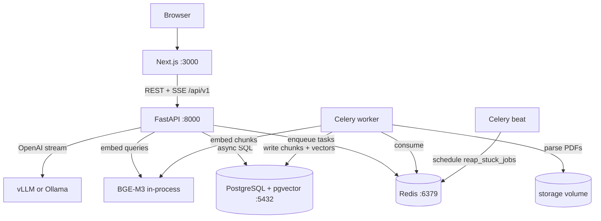
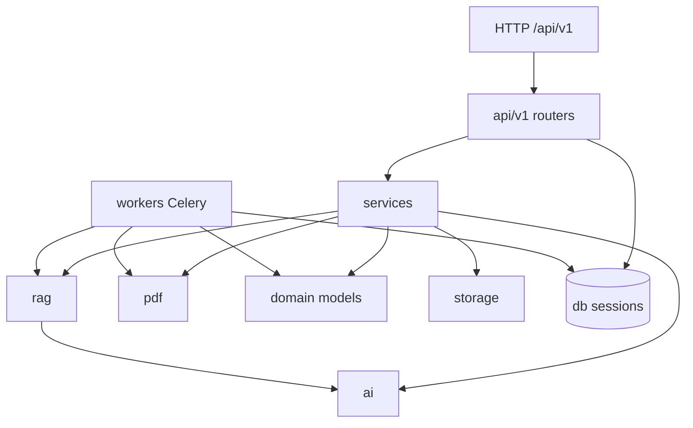

# Architecture

How DocuPilot’s services fit together, which tools own which job, and how the
frontend talks to the backend. For local run instructions see
[DEVELOPMENT.md](DEVELOPMENT.md). For request pipelines see
[DATA_FLOWS.md](DATA_FLOWS.md). For embeddings and retrieval see [RAG.md](RAG.md).

---

## System context

DocuPilot is a **local, unrestricted workspace** (no auth). The browser talks
only to the Next.js frontend; the frontend calls the FastAPI backend over HTTP.
Heavy PDF work runs asynchronously on Celery workers. The LLM is a self-hosted
OpenAI-compatible server (vLLM in Compose; Ollama is fine for hybrid/dev).

| Service      | Role                                                                                                 | Default port |
| ------------ | ---------------------------------------------------------------------------------------------------- | ------------ |
| **frontend** | Next.js UI (App Router, standalone in prod)                                                          | `3000`       |
| **backend**  | FastAPI API, query embedding, RAG orchestration, SSE                                                 | `8000`       |
| **worker**   | Celery: PDF ingest (parse → chunk → embed → store)                                                   | –            |
| **beat**     | Celery beat: periodic `reap_stuck_jobs`                                                              | –            |
| **db**       | PostgreSQL + pgvector (documents, chunks, chats, vectors)                                            | `5432`       |
| **redis**    | Celery broker (DB 1) + result backend (DB 2)                                                         | `6379`       |
| **vllm**     | Self-hosted LLM (OpenAI-compatible HTTP)                                                             | `8001`       |
| **BGE-M3**   | Embeddings (and optional reranker) loaded **in-process** in backend + worker — not its own container | –            |

---

## Tools and why they are used

| Tool                                 | Where it runs                       | Why                                                         |
| ------------------------------------ | ----------------------------------- | ----------------------------------------------------------- |
| **Next.js**                          | `frontend` container / host         | App Router UI, i18n, standalone Docker output               |
| **FastAPI**                          | `backend`                           | Async HTTP API, SSE streaming, OpenAPI at `/docs`           |
| **SQLAlchemy + Alembic**             | backend + worker                    | Async sessions for API; sync sessions for Celery/migrations |
| **PostgreSQL + pgvector**            | `db`                                | Relational data + 1024-dim HNSW vector search               |
| **Redis + Celery**                   | `redis` / `worker` / `beat`         | Durable ingest queue; beat reaps stuck jobs                 |
| **Docling** (+ **PyMuPDF** fallback) | worker                              | PDF → markdown + page map                                   |
| **FlagEmbedding BGE-M3**             | backend + worker processes          | Multilingual embeddings for chunks and queries              |
| **BGE reranker v2-m3**               | backend (in-process, on by default) | Cross-encoder reordering of retrieved chunks                |
| **vLLM** (or Ollama)                 | GPU host / container                | Chat and summary generation via OpenAI-compatible API       |
| **WeasyPrint**                       | backend                             | Markdown → HTML → downloadable PDF                          |
| **Docker Compose**                   | host                                | Dev and prod multi-service orchestration                    |

Embeddings can optionally be offloaded to a single HTTP service via
`EMBEDDING_BASE_URL` so the model loads in one place instead of every process.
See [RAG.md](RAG.md).

---

## Backend layers

The backend is a modular monolith under `apps/backend/app/`:

| Layer        | Path            | Responsibility                                                     |
| ------------ | --------------- | ------------------------------------------------------------------ |
| **api**      | `app/api/v1/`   | HTTP routers: documents, chats, messages, search, generate, health |
| **services** | `app/services/` | Orchestration: document, chat, rag, generation                     |
| **rag**      | `app/rag/`      | Chunk, embed, retrieve, rerank, assemble context                   |
| **ai**       | `app/ai/`       | vLLM client, prompts, language detection                           |
| **pdf**      | `app/pdf/`      | Parse (Docling/PyMuPDF), generate (WeasyPrint)                     |
| **workers**  | `app/workers/`  | Celery app + `ingest_document` / `reap_stuck_jobs`                 |
| **domain**   | `app/domain/`   | SQLAlchemy models                                                  |
| **db**       | `app/db/`       | Async + sync engines/sessions                                      |
| **core**     | `app/core/`     | Middleware, exceptions                                             |

Deeper detail: [BACKEND.md](BACKEND.md).

---

## Frontend shape

The UI lives under `apps/frontend` as a Next.js App Router app. All product
routes sit in the `(workspace)` group (no URL segment): home/chats, documents,
chat detail, search, generate. There is **no** Next.js API/BFF layer — the
browser calls FastAPI directly.

Deeper detail: [FRONTEND.md](FRONTEND.md).

---

## Backend ↔ frontend integration

### Base URL and CORS

- Frontend reads `NEXT_PUBLIC_API_URL` (default `http://localhost:8000`) and
  prefixes all calls with `/api/v1` (`apps/frontend/lib/api.ts`).
- Backend CORS allow-list is `ALLOWED_ORIGINS` (comma-separated or JSON array).
  Defaults include `http://localhost:3000` and `http://localhost:8080`.

### Call patterns

| Pattern              | How                                                    | Used for                                        |
| -------------------- | ------------------------------------------------------ | ----------------------------------------------- |
| **JSON REST**        | `fetch` + `Content-Type: application/json`             | CRUD, search, summary, health                   |
| **Multipart upload** | `FormData` with a `file` field                         | `POST /documents`, `POST /chats/{id}/documents` |
| **SSE stream**       | `fetch` + `ReadableStream` (not `EventSource`)         | `POST /chats/{id}/messages/stream`              |
| **Job polling**      | React Query refetch while status is PENDING/PROCESSING | `GET /documents/{id}/job`                       |
| **Health polling**   | React Query ~15s interval                              | `GET /health/system`                            |

### SSE chat contract

Backend emits Server-Sent Events. The frontend parses `data:` lines into:

| Event `type` | Meaning                                     |
| ------------ | ------------------------------------------- |
| `token`      | Incremental assistant text (`text` field)   |
| `done`       | Stream finished (`message_id`, `citations`) |
| `error`      | Failure (`detail`)                          |

Comment frames (`: keepalive`) keep proxies from idle-closing the connection
(`SSE_KEEPALIVE_SECONDS`). If the client aborts mid-stream, the backend may
persist a partial reply with `meta.interrupted = true`.

### Auth / tenancy

None. Every document, chat, and generated PDF is globally visible in the local
workspace. Do not expose the stack to an untrusted network without adding your
own access control.

---

## Related docs

| Doc                              | Contents                                          |
| -------------------------------- | ------------------------------------------------- |
| [DATA_FLOWS.md](DATA_FLOWS.md)   | Ingest, chat/RAG, search, generate sequences      |
| [RAG.md](RAG.md)                 | Chunking, embeddings, pgvector, rerank, citations |
| [BACKEND.md](BACKEND.md)         | Modules, domain model, API catalog, Celery        |
| [FRONTEND.md](FRONTEND.md)       | Routes, data layer, feature flows, i18n           |
| [DEVELOPMENT.md](DEVELOPMENT.md) | How to run locally                                |
| [../README.md](../README.md)     | Quickstart, env table, production compose         |
