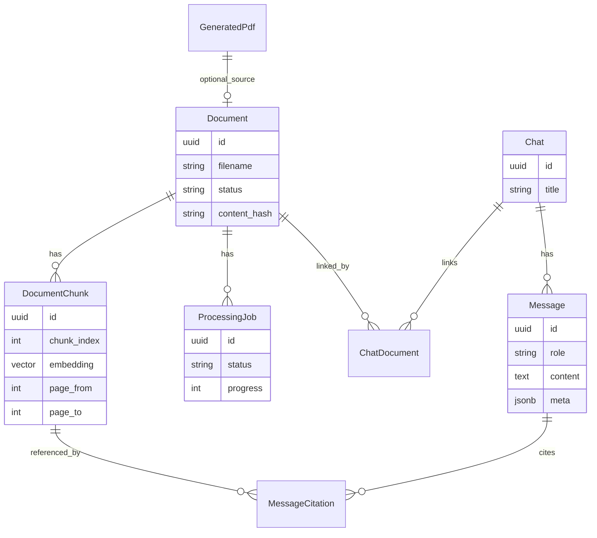

# Backend

FastAPI modular monolith under `apps/backend`. Architecture context:
[ARCHITECTURE.md](ARCHITECTURE.md). Pipelines: [DATA_FLOWS.md](DATA_FLOWS.md).
Vectors: [RAG.md](RAG.md). Ops knobs also summarized in
[apps/backend/README.md](../apps/backend/README.md). Live schemas:
http://localhost:8000/docs

---

## Module map

```
apps/backend/app/
├── main.py              FastAPI app factory, CORS, lifespan warmup
├── config.py            Pydantic settings from env
├── schemas.py           Request/response DTOs
├── deps.py              SessionDep
├── storage.py           Local filesystem PDF storage + SHA-256 keys
├── logging.py           structlog
├── api/v1/              HTTP routers
├── services/            document, chat, rag, generation
├── rag/                 chunker, embedder, retriever, reranker, context_assembler
├── ai/                  vllm_client, prompts, language
├── pdf/                 parser (Docling/PyMuPDF), generator (WeasyPrint)
├── workers/             celery_app, tasks
├── domain/models.py     ORM entities
├── db/session.py        async + sync engines
└── core/                middleware, exceptions
```

Routers are mounted under `/api/v1` from `app/api/v1/__init__.py`.

---

## Domain model

No user/owner tables — everything is a **global local workspace**.



Document / job status: `PENDING` | `PROCESSING` | `READY` | `FAILED`.

---

## API catalog

All paths below are under `/api/v1`. Prefer Swagger for request/response bodies.

### Health

| Method | Path             | Purpose                                      |
| ------ | ---------------- | -------------------------------------------- |
| GET    | `/health`        | Liveness                                     |
| GET    | `/health/ready`  | Database readiness                           |
| GET    | `/health/llm`    | LLM reachability                             |
| GET    | `/health/system` | Aggregated api / db / redis / worker / model |

### Documents — `app/api/v1/documents.py`

| Method | Path                       | Purpose                                        |
| ------ | -------------------------- | ---------------------------------------------- |
| POST   | `/documents`               | Upload PDF (stream to disk, dedupe by SHA-256) |
| GET    | `/documents`               | List (`limit` / `before` cursor pagination)    |
| GET    | `/documents/{id}`          | Get one                                        |
| GET    | `/documents/{id}/job`      | Latest processing job                          |
| POST   | `/documents/{id}/reingest` | Wipe chunks and re-queue ingest                |
| DELETE | `/documents/{id}`          | Delete                                         |

### Chats — `app/api/v1/chats.py`

| Method    | Path                    | Purpose                             |
| --------- | ----------------------- | ----------------------------------- |
| POST      | `/chats`                | Create                              |
| GET       | `/chats`                | List                                |
| GET       | `/chats/{id}`           | Get                                 |
| PATCH/PUT | `/chats/{id}`           | Update (title, linked document_ids) |
| DELETE    | `/chats/{id}`           | Delete                              |
| POST      | `/chats/{id}/documents` | Upload PDF attached to chat         |
| GET       | `/chats/{id}/messages`  | List messages                       |

### Messages — `app/api/v1/messages.py`

| Method | Path                          | Purpose               |
| ------ | ----------------------------- | --------------------- |
| POST   | `/chats/{id}/messages/stream` | SSE RAG answer stream |

SSE event types: `token`, `done`, `error`. Keepalive comment frames every
`SSE_KEEPALIVE_SECONDS`. See [ARCHITECTURE.md](ARCHITECTURE.md#sse-chat-contract).

### Search — `app/api/v1/search.py`

| Method | Path      | Purpose                       |
| ------ | --------- | ----------------------------- |
| POST   | `/search` | Semantic search hits (no LLM) |

### Generate — `app/api/v1/generate.py`

| Method | Path                          | Purpose                        |
| ------ | ----------------------------- | ------------------------------ |
| POST   | `/generate/summary`           | LLM summary over selected docs |
| POST   | `/generate/pdf`               | Persist markdown as PDF        |
| GET    | `/generate/pdf`               | List generated PDFs            |
| GET    | `/generate/pdf/{id}/download` | Download file                  |

Cross-cutting: every request gets `X-Request-ID` (generated if absent).

---

## Celery

**App:** `app/workers/celery_app.py`  
**Tasks:** `app/workers/tasks.py`

| Task              | Trigger                 | Behavior                                                                                                                |
| ----------------- | ----------------------- | ----------------------------------------------------------------------------------------------------------------------- |
| `ingest_document` | After upload / reingest | Parse → language → chunk → embed → write chunks; updates job progress; autoretry on transient DB/network errors (max 3) |
| `reap_stuck_jobs` | Beat every **300s**     | Marks PROCESSING jobs older than `INGEST_STUCK_AFTER_SECONDS` (default 900) as FAILED                                   |

Worker config highlights: JSON serializers, `task_acks_late=True`,
`worker_prefetch_multiplier=1` (heavy PDF tasks).

Run (hybrid):

```bash
uv run celery -A app.workers.celery_app.celery_app worker --loglevel=info --concurrency=1
uv run celery -A app.workers.celery_app.celery_app beat --loglevel=info
```

Compose starts both `worker` and `beat` services.

---

## PDF stack

| Step             | Library                      | Module                   |
| ---------------- | ---------------------------- | ------------------------ |
| Parse (primary)  | Docling                      | `app/pdf/parser.py`      |
| Parse (fallback) | PyMuPDF                      | same                     |
| Page cap         | `MAX_DOCUMENT_PAGES` (2000)  | ingest fails above limit |
| Export           | Markdown → HTML → WeasyPrint | `app/pdf/generator.py`   |

---

## Configuration

Operator-facing env vars: root [README](../README.md#environment-variables) and
[`.env.example`](../.env.example). Backend-specific highlights (SSE, history,
ingest reaper, upload limits): [apps/backend/README.md](../apps/backend/README.md).
Full field list: `app/config.py`.
