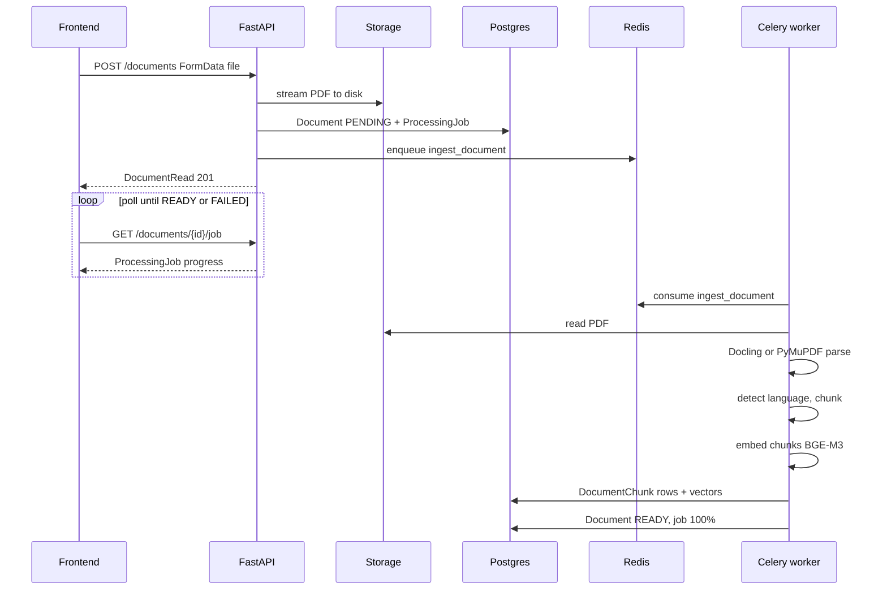
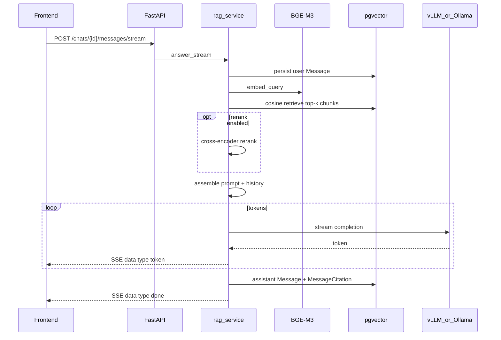

# Data flows

End-to-end request and pipeline paths. System overview:
[ARCHITECTURE.md](ARCHITECTURE.md). Vector/retrieval detail: [RAG.md](RAG.md).

Key code:

- Upload / jobs: `apps/backend/app/services/document_service.py`, `app/api/v1/documents.py`
- Ingest worker: `apps/backend/app/workers/tasks.py`
- Chat/RAG: `apps/backend/app/services/rag_service.py`, `app/api/v1/messages.py`
- Frontend client: `apps/frontend/lib/api.ts`
- Chat UI: `apps/frontend/app/(workspace)/chat/[id]/page.tsx`

---

## 1. Document ingest

Upload creates a `Document` (PENDING) and a `ProcessingJob`, stores the PDF on
disk (SHA-256 dedup), and enqueues Celery task `ingest_document`. The UI polls
`GET /api/v1/documents/{id}/job` until the document is READY or FAILED.



Status progression: `PENDING` → `PROCESSING` → `READY` (or `FAILED` with
`error`). Re-run with `POST /documents/{id}/reingest` (deletes chunks, resets
PENDING, re-enqueues).

Beat task `reap_stuck_jobs` (every 300s) marks PROCESSING jobs older than
`INGEST_STUCK_AFTER_SECONDS` as FAILED.

---

## 2. Chat / RAG answer (SSE)

Sending a message streams tokens to the UI while the backend retrieves grounded
context from linked documents (or the full corpus if the chat has none).



Frontend `streamMessage()` reads the body as a stream, accumulates `token`
events, and on `done` merges citations into the React Query cache. Aborting the
fetch cancels the request; the backend may keep a partial reply marked
interrupted.

See [RAG.md](RAG.md) for retrieve / rerank / citation scoring.

---

## 3. Semantic search


Returns scored hits with snippet and page range — no LLM generation. Document
scope can be restricted to selected READY documents from the UI picker.

---

## 4. Generate: summary and PDF export

```mermaid
flowchart TD
    subgraph summary [Summarize]
        S1[POST /generate/summary] --> S2[retrieve top chunks]
        S2 --> S3[buffered LLM completion]
        S3 --> S4[markdown text to UI]
    end
    subgraph export [Export PDF]
        E1[POST /generate/pdf] --> E2[markdown to HTML]
        E2 --> E3[WeasyPrint PDF]
        E3 --> E4[GeneratedPdf row + file]
        E4 --> E5[GET /generate/pdf/{id}/download]
    end
    S4 -.->|user edits then exports| E1
```

The Generate page is a two-tab flow: summarize into an editor, then export
markdown to a downloadable PDF. Code: `app/services/generation_service.py`,
`app/pdf/generator.py`, `apps/frontend/app/(workspace)/generate/page.tsx`.

---

## Cross-cutting notes

- **API prefix:** all routes under `/api/v1`.
- **Request ID:** `X-Request-ID` on requests/responses; bound into structlog.
- **Dedup:** identical PDF bytes (SHA-256) reuse the existing document row on
  upload instead of creating a duplicate.
- **Health:** `GET /health/system` aggregates api, database, redis, worker, and
  model status for the header widget.
