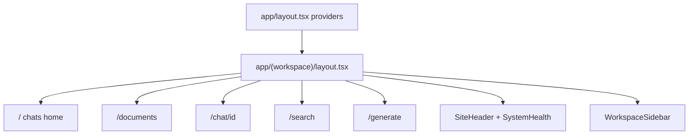

# Frontend

Next.js App Router UI under `apps/frontend`. System context:
[ARCHITECTURE.md](ARCHITECTURE.md). Runbook:
[DEVELOPMENT.md](DEVELOPMENT.md). Short run notes:
[apps/frontend/README.md](../apps/frontend/README.md).

---

## Routes and layout

There is no `middleware.ts` and no `app/api/*` BFF — the browser calls FastAPI
directly via `NEXT_PUBLIC_API_URL`.



| URL          | File                                 | Role                                   |
| ------------ | ------------------------------------ | -------------------------------------- |
| `/`          | `app/(workspace)/page.tsx`           | Chat list, create / rename / delete    |
| `/documents` | `app/(workspace)/documents/page.tsx` | Upload, status, reingest, delete       |
| `/chat/[id]` | `app/(workspace)/chat/[id]/page.tsx` | Streaming chat, attach docs, citations |
| `/search`    | `app/(workspace)/search/page.tsx`    | Semantic search + document filter      |
| `/generate`  | `app/(workspace)/generate/page.tsx`  | Summarize → edit markdown → export PDF |

`(workspace)` is a route group (no URL segment). Shell:
`app/(workspace)/layout.tsx` — sidebar + header + main scroll area.

Root `app/layout.tsx` wraps fonts, React Query `Providers`, theme,
direction (RTL), `next-intl`, and toasts.

---

## Data layer

| Piece        | Path                  | Role                                                      |
| ------------ | --------------------- | --------------------------------------------------------- |
| API client   | `lib/api.ts`          | `fetch` helpers, uploads, SSE `streamMessage`, `ApiError` |
| Types        | `lib/types.ts`        | DTOs + `StreamEvent`                                      |
| Query hooks  | `lib/queries/`        | TanStack Query wrappers                                   |
| Query keys   | `lib/queries/keys.ts` | Centralized cache keys                                    |
| Query client | `lib/query-client.ts` | Defaults (stale time, retry skips 4xx)                    |

Base URL: `process.env.NEXT_PUBLIC_API_URL ?? "http://localhost:8000"`, then
`/api/v1`. Integration details (CORS, SSE contract):
[ARCHITECTURE.md](ARCHITECTURE.md#backend--frontend-integration).

---

## Feature flows

### Documents

- Hooks: `useDocuments({ poll: true })`, `useDocumentJob`, upload / reingest /
  delete mutations.
- Adaptive list polling while any document is PENDING/PROCESSING; per-doc job
  polling for progress bars.
- PDF-only validation; drag-and-drop supported.

### Chat

- Create chat on home → navigate to `/chat/{id}`.
- Attach READY docs via picker (`useUpdateChat`) or upload into the chat.
- Send uses `streamMessage()` with optimistic user message, token accumulation,
  citation merge on `done`, AbortSignal on unmount/new send.
- Send is gated when System Health reports the **model** component down.

### Search

- `useSearch()` mutation → `POST /search` with optional document IDs.
- Shows score, snippet, page range; race-safe with a search id ref.

### Generate

- Tab 1: pick docs + optional instruction → `useSummarize()` → markdown editor.
- Tab 2: preview (`components/markdown.tsx`) → `useGeneratePdf()` → open
  download URL in a new tab.

---

## System Health

| Piece     | Path                                                      |
| --------- | --------------------------------------------------------- |
| Widget    | `components/system-health.tsx`                            |
| Hook      | `lib/queries/health.ts` (`useSystemHealth`, ~15s refetch) |
| Placement | `components/site-header.tsx`                              |

Shows overall status plus **api**, **database**, **redis**, **worker**,
**model**. Backed by `GET /api/v1/health/system`.

---

## UI stack and i18n

| Concern      | Tech                                                                  |
| ------------ | --------------------------------------------------------------------- |
| Framework    | Next.js 16, React 19, `output: "standalone"`                          |
| Styling      | Tailwind CSS 4, shadcn/ui (`components/ui/*`)                         |
| Server state | TanStack React Query                                                  |
| i18n         | `next-intl` — `messages/en.json`, `messages/ar.json`, cookie `locale` |
| RTL          | Direction provider + sidebar flip for Arabic                          |
| Theming      | `next-themes` (light/dark)                                            |
| Markdown     | `react-markdown` + `remark-gfm`                                       |
| Toasts       | sonner                                                                |
| Icons        | lucide-react                                                          |

Shared building blocks: `DocumentPicker`, `Markdown`, `PageHeader`,
`HelpDialog`, `StatusDot`, rename-chat dialog.

---

## Scripts and config

From `apps/frontend`:

```bash
pnpm install
pnpm dev          # :3000
pnpm lint
pnpm format
```

Important config: `next.config.ts` (standalone output, next-intl plugin),
`i18n/request.ts`, `components.json` (shadcn). Only frontend env required for
API reachability is `NEXT_PUBLIC_API_URL`.
