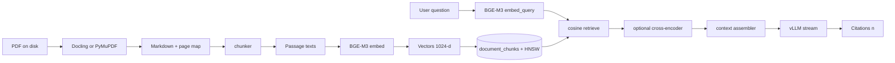
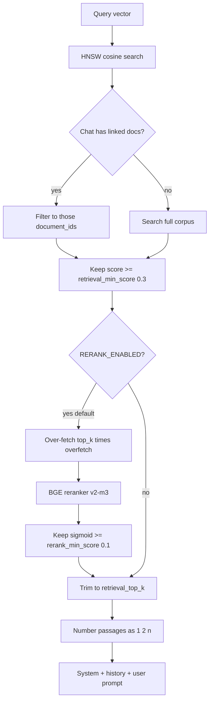

# RAG and vectors

How DocuPilot turns PDFs into searchable vectors and grounds chat answers in
retrieved chunks. Pipelines that use this stack:
[DATA_FLOWS.md](DATA_FLOWS.md). Defaults live in
`apps/backend/app/config.py`.

---

## Pipeline overview

---

## Chunking

**Module:** `apps/backend/app/rag/chunker.py`

| Setting               | Default | Meaning                         |
| --------------------- | ------- | ------------------------------- |
| `chunk_target_chars`  | `1800`  | Target chunk size               |
| `chunk_overlap_chars` | `200`   | Overlap between adjacent chunks |

Chunks are structure-aware (prefer splits on headings/paragraphs) and store
metadata used at citation time: `page_from` / `page_to`, optional
`section_title`, `chunk_index`.

---

## Embeddings (BGE-M3)

**Module:** `apps/backend/app/rag/embedder.py`

| Setting              | Default                                        |
| -------------------- | ---------------------------------------------- |
| `EMBEDDING_MODEL`    | `BAAI/bge-m3`                                  |
| `EMBEDDING_DIM`      | `1024`                                         |
| `EMBEDDING_USE_FP16` | `false` (CPU-friendly)                         |
| `EMBEDDING_DEVICE`   | blank = auto                                   |
| `EMBEDDING_WARMUP`   | `false` (set `true` to preload at API startup) |
| `EMBEDDING_BASE_URL` | empty = in-process FlagEmbedding               |

**Query vs passage.** Queries use BGE-M3’s query instruction prefix via
`embed_query()`. Passages/chunks are embedded without that prefix so the index
matches how the model was trained.

**Where the model loads.** By default both the **backend** (query embed at
chat/search time) and the **worker** (chunk embed at ingest) load BGE-M3
in-process (~2.3 GB). Set `EMBEDDING_BASE_URL` to a self-hosted HTTP embedder
(`POST {base}/embed` with `texts` + `is_query`) to load the model once.

---

## Storage in pgvector

**Model:** `DocumentChunk.embedding` — `Vector(1024)` in
`apps/backend/app/domain/models.py`. Extension and HNSW index come from Alembic
`0001_initial`.

| Aspect         | Value                                                     |
| -------------- | --------------------------------------------------------- |
| Distance / ops | Cosine (`vector_cosine_ops`)                              |
| Index          | HNSW, `m=16`, `ef_construction=64`                        |
| Query breadth  | `SET hnsw.ef_search` from `HNSW_EF_SEARCH` (default `64`) |
| Score          | `1.0 - cosine_distance` (higher is better)                |

Only READY documents’ chunks participate in normal product flows; ingest must
finish before chat/search quality is meaningful for that file.

---

## Retrieve → filter → rerank → assemble

**Modules:** `retriever.py`, `reranker.py`, `context_assembler.py`,
`services/rag_service.py`

| Setting                        | Default                   | Role                                                   |
| ------------------------------ | ------------------------- | ------------------------------------------------------ |
| `retrieval_top_k`              | `8`                       | Final passages sent to the LLM                         |
| `retrieval_min_score`          | `0.3`                     | Drop weak cosine hits (safety: keep top-1 if all fail) |
| `rerank_enabled`               | `true`                    | Cross-encoder on by default                            |
| `rerank_model`                 | `BAAI/bge-reranker-v2-m3` | FlagEmbedding CrossEncoder                             |
| `rerank_overfetch`             | `4`                       | Retrieve `top_k * 4` candidates before rerank          |
| `rerank_min_score`             | `0.1`                     | Floor on sigmoid rerank scores                         |
| `max_history_messages`         | `10`                      | Recent turns sent verbatim                             |
| `max_history_summary_messages` | `50`                      | Cap on history rows loaded (long chats may summarize)  |

**Citations.** The model is prompted to cite passages as `[1]`, `[2]`, …. After
streaming, the backend extracts cited indices and persists `MessageCitation`
rows only for cited chunks that clear the score floor. The UI renders those
markers against source pages.

**Comparison mode.** Heuristics in the assembler/prompts kick in when the chat
is attached to multiple documents so the model can contrast sources.

---

## Search vs chat vs summary

| Feature         | Uses retrieve/rerank?    | Uses LLM?                  |
| --------------- | ------------------------ | -------------------------- |
| Semantic search | Yes                      | No — returns hits JSON     |
| Chat stream     | Yes                      | Yes — streaming completion |
| Summary         | Yes (often higher top-k) | Yes — buffered completion  |

All three share the same embedding model and chunk index; only the post-retrieve
path differs.
